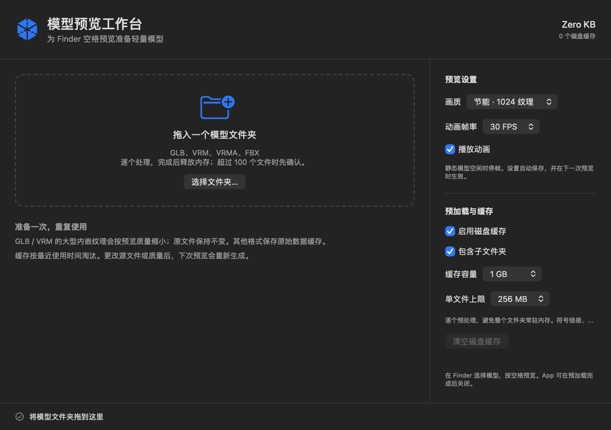

# Quick Look 3D Plugin

**English** | [日本語](./README.ja.md) | [한국어](./README.ko.md)

A macOS Quick Look plugin that previews **`.vrm` / `.vrma` / `.glb` / `.fbx`** files in 3D.

Select a file in Finder and press Space to spin the model around. Animations play
automatically.


## Install

1. Download `QuickLook3D.dmg` from the
   [latest release](https://github.com/sawa-zen/quick-look-3d/releases/latest) and open it
2. Drag **QuickLook3D.app** into your Applications folder
3. **Launch the app once** — this registers the Quick Look extension with macOS
   (you can close the window afterwards)
4. Open **System Settings → General → Login Items & Extensions → Extensions (Quick Look)**
   and turn on **Quick Look 3D**

> The released build is notarized by Apple, so Gatekeeper won't warn you.

## Usage

Select a supported file in Finder and press **Space** (or right-click → Quick Look).

| Format | Notes |
|---|---|
| `.vrm` | VRM avatar (0.x / 1.0) |
| `.vrma` | VRM animation. No mesh, so the skeleton is shown and the animation plays |
| `.glb` | glTF binary (Draco-compressed meshes included). Plays embedded animation if present |
| `.fbx` | FBX model. Plays embedded animation if present |

- Drag to rotate, scroll to zoom
- Files with no mesh/skin (a skin-less `.fbx`, or `.vrma`) are shown as a skeleton

## Folder preload and persistent preview settings (this fork)

The app includes a folder drop workspace, automatically saved quality/FPS preferences,
sequential preparation, cancellation, and a bounded disk cache shared with previews.
More than 100 supported files require confirmation before preparation. Economy mode
reduces supported embedded textures to 1024 pixels and defaults to 30 FPS. Source
files remain untouched; close the app after preparation to release its memory.

See [implementation, measured memory, and validation](docs/PRELOAD-SETTINGS-MEMORY.md).
These features are in this fork's source/local build; the upstream release linked
above does not include them. Local builds use ad-hoc signing and have not been notarized.



## Troubleshooting

- Make sure install steps 3–4 (**launch once** and **enable the extension**) are done
- Otherwise refresh the Quick Look cache:
  ```bash
  qlmanage -r && qlmanage -r cache
  ```
- `.gltf` (the multi-file form with external `.bin` / textures) is not supported.
  Use a single-file `.glb` instead.

## License

The project code is [MIT](./LICENSE). The bundled third parties (three.js /
@pixiv/three-vrm / fflate) are also MIT — see
[THIRD_PARTY_LICENSES.md](./THIRD_PARTY_LICENSES.md). No avatar or model data is bundled.

## For developers

Build instructions, architecture, and distribution (signing / notarization) are in
**[docs/DEVELOPMENT.md](./docs/DEVELOPMENT.md)**.
