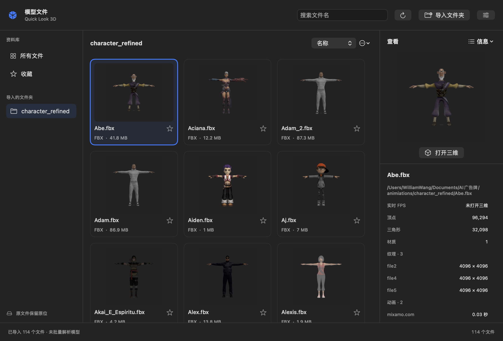

# Quick Look 3D Plugin

**English** | [日本語](./README.ja.md) | [한국어](./README.ko.md)

A macOS Quick Look plugin that previews **`.vrm` / `.vrma` / `.glb` / `.fbx`** files in 3D.

Select a file in Finder and press Space to spin the model around. Animations play
automatically.


## Install

1. Download `QuickLook3D.dmg` from the
   [latest release](https://github.com/sawa-zen/quick-look-3d/releases/latest) and open it
2. Drag **QuickLook3D.app** into your Applications folder
3. **Launch the app once** — this registers the Quick Look extension with macOS
   (you can close the window afterwards)
4. Open **System Settings → General → Login Items & Extensions → Extensions (Quick Look)**
   and turn on **Quick Look 3D**

> The released build is notarized by Apple, so Gatekeeper won't warn you.

## Usage

Select a supported file in Finder and press **Space** (or right-click → Quick Look).

| Format | Notes |
|---|---|
| `.vrm` | VRM avatar (0.x / 1.0) |
| `.vrma` | VRM animation. No mesh, so the skeleton is shown and the animation plays |
| `.glb` | glTF binary (Draco-compressed meshes included). Plays embedded animation if present |
| `.fbx` | FBX model. Plays embedded animation if present |

- Drag to rotate, scroll to zoom
- Files with no mesh/skin (a skin-less `.fbx`, or `.vrma`) are shown as a skeleton

## Model file viewer (this fork)

The main app is a model file viewer with persistent folder/file imports, a searchable
thumbnail grid, favorites, an interactive 3D view, and selectable model information.
Importing a folder indexes its files; it does not parse every model or copy every FBX.
More than 100 supported files require confirmation. Browsing uses static thumbnails;
3D rendering starts when a model is opened and stops when returning to the list.

The information panel offers measured rendering FPS, vertices, triangles, materials,
texture dimensions, and animation durations. Quality, animation, cache budgets,
selected fields, and favorites survive restart. Data caches support up to 256 GiB;
favorites are protected from automatic eviction. FBX retains its existing parser;
a raw FBX cache does not remove the parsing or GPU-upload cost.

Independent Quick Look preview and Finder thumbnail extensions are bundled. The
Finder provider does not require a library import; macOS owns its thumbnail cache
and chooses which installed provider handles each format.

See [viewer behavior, memory measurements, and acceptance results](docs/MODEL-VIEWER.md).
The earlier [preload measurements](docs/PRELOAD-SETTINGS-MEMORY.md) describe the previous
workspace. These changes are in this fork's source/local build; the upstream release
linked above does not include them. Local builds use ad-hoc signing and have not
been notarized.



## Troubleshooting

- Make sure install steps 3–4 (**launch once** and **enable the extension**) are done
- Otherwise refresh the Quick Look cache:
  ```bash
  qlmanage -r && qlmanage -r cache
  ```
- `.gltf` (the multi-file form with external `.bin` / textures) is not supported.
  Use a single-file `.glb` instead.

## License

The project code is [MIT](./LICENSE). The bundled third parties (three.js /
@pixiv/three-vrm / fflate) are also MIT — see
[THIRD_PARTY_LICENSES.md](./THIRD_PARTY_LICENSES.md). No avatar or model data is bundled.

## For developers

Build instructions, architecture, and distribution (signing / notarization) are in
**[docs/DEVELOPMENT.md](./docs/DEVELOPMENT.md)**.
